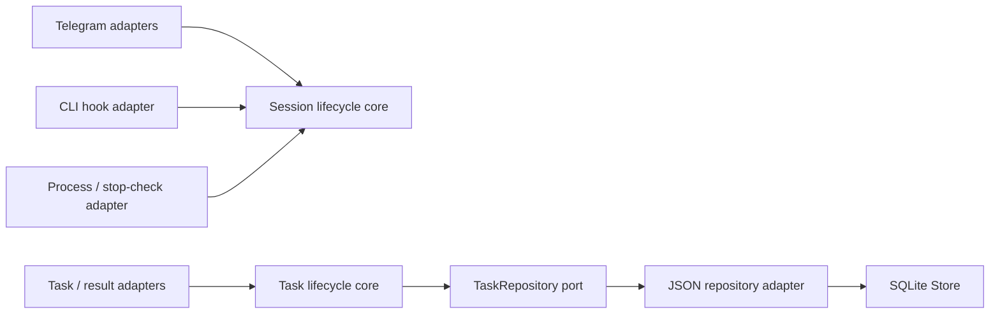

# Lifecycle architecture

Session and task state rules live in `src/core/`. The core has no Telegram, SQLite, Bun, tmux, CLI, clock, timer or filesystem dependency. Adapters supply events and timestamps; storage is accessed through a repository port. UI rendering and process effects remain in the daemon adapters.

## Session events

`src/core/session.ts` defines `SessionState`, typed events and the pure `reduceSession` function. `applySessionEvent` is the explicit mutation boundary for existing daemon sessions. Session creation supplies the initial state; adapters then use events rather than assigning lifecycle fields independently.

| Event | Rule |
| --- | --- |
| Delivered message / prompt | Clears an earlier stop request; opens a turn when necessary. A new prompt after a stop gets a new turn boundary. |
| Context-only delivery | Resets the old stop marker without creating a model turn. |
| Activity | Can open a terminal-originated turn; cannot revive a stopped turn. |
| Permission requested / resolved | Moves between working and waiting; stopped turns cannot be revived through late permission events. |
| Stop requested | Allocates a monotonic stop token. Sending Escape alone does not make the session idle. |
| Stop checked | Applies only to the matching timestamp and token while that request is pending. A failed check preserves working/waiting; a confirmed check closes the turn. |
| Stop hook / ended | Closes the turn and records its end boundary. |
| Reply sent / stuck | Updates turn metadata through the same transition boundary. |

Timers, socket writes, file-change tracking, stream closing, dashboards, task accounting and Telegram notifications remain adapter effects. Late timestamped activity/Stop hooks from before the active turn are ignored. Legacy hooks without timestamps retain the existing post-Stop grace rules; these cannot provide exact cross-turn correlation.

Stop checks carry their original token across asynchronous tmux calls and timers. Both successful and failed completions are rejected after a newer prompt/stop, including when two requests share the same millisecond timestamp. An ignored completion also sends no obsolete failure notification.

## Task state and persistence

`src/core/task.ts` owns task scope matching, lifecycle transitions, batch identity merging and the `Tasks` service. A closed task remains closed when a late result-ready event arrives; reopening requires an explicit open event. A late ready event never replaces another task's current-scope pointer.

The service receives a `TaskRepository`, an ID factory and a clock. Tests can reconstruct it over an in-memory repository without loading SQLite or Telegram. `src/daemon/taskstore.ts` implements the port against the existing JSON key/value records.

A repository commit writes both the task record and the current-scope pointer in one SQLite transaction through `Store.atomic`. If either write fails, both roll back. Existing database keys and serialized task records remain compatible; no schema migration is needed.

Offline session-resume events use the same task metadata merger as message batching. A queue containing multiple task IDs retains all identities, so shared execution can remain explicitly unallocated instead of silently losing or selecting one task.

## Verification and extension rules

`test/core.test.ts` checks pure transition invariants, completion-order permutations, restored state, task scope isolation and the core's infrastructure boundary. Adapter tests cover stale tmux failures/checks; task tests exercise transaction rollback; the daemon test verifies offline task identity reaches the resumed accounting stage.

Add lifecycle rules to the core and effects to adapters. Supply time explicitly to core events. Keep task persistence changes behind the repository port, including atomic multi-record writes. New transport adapters should reuse the same events rather than implementing their own status logic.

This extraction covers lifecycle rules. Telegram rendering, queues, transcript parsers, accounting aggregation and process supervision still live in the existing daemon modules; it does not replace them with a new runtime or queue protocol.
